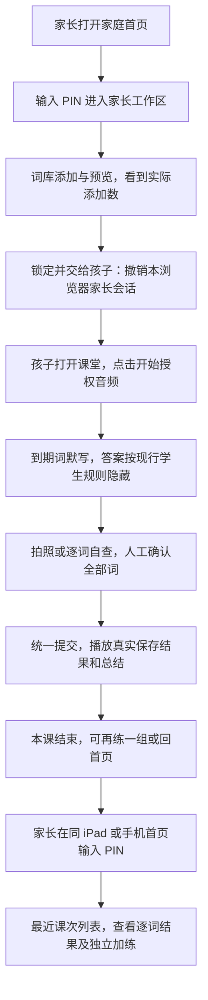
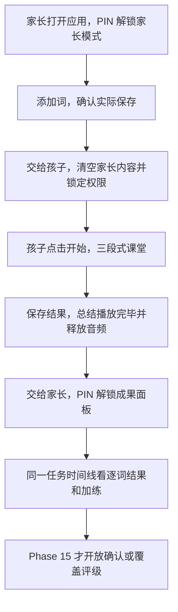
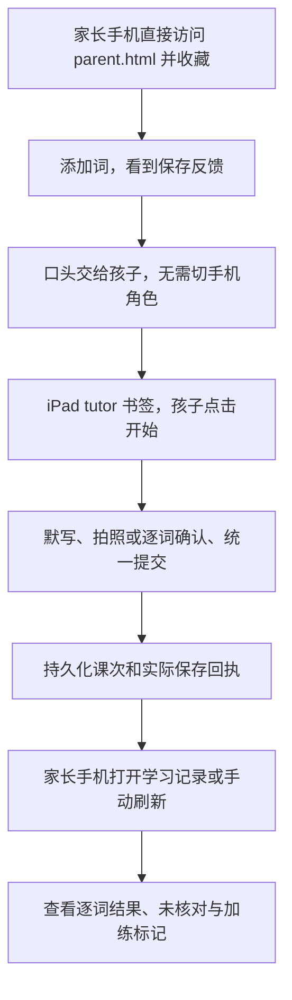

# 家长管理端与实时课堂融合交互评审

评审日期：2026-10-09。范围：只读本工作目录的代码和规划，提出交互与交付建议；本文件是唯一新增文件。未运行构建、测试、部署或真机操作，未做 git 提交。下文的页面、接口和数据补充均为建议，不代表已实现或已批准修改既有决策。

## 1. 判断与推荐

推荐 **A：统一首页、两个独立任务入口，课堂内不切换角色**。学生进入课堂，家长进入受 PIN 保护的“学习记录／词库／设置”；家长页支持手机，既可分设备使用，也可在同一 iPad 上交接。融合的核心是同一份持久课次结果贯穿“准备词库—完成课堂—查看成果”，不是把词库管理组件塞进课堂。

这个形态需要明确修订 Phase 9 D-04：保留“课堂中没有管理操作”的产品目的，放弃“家长必须手输 URL 且不设门禁”的实现约束。首页公开家长入口后，PIN 必须由服务端保护管理 API 和成果读取，单纯把按钮藏起来或前端验证 PIN 不成立。

死线前只做“首页＋门禁＋最近课次列表＋逐词结果＋加练记录＋可靠的保存状态”。不做家长覆盖评分、完整对话回放、照片历史、趋势分析、选单元立即开课、SPA 合并或全站样式重写。Phase 15 继续负责家长反馈写入与恢复的剩余部分。

**优先级仍是 13.1＋VPS 真机闭环。** 10 月 21 日是既有实时方案切换检查，不是当前规划中“所有融合功能必须交付”的承诺；本评审把最小融合切片作为这一日期前可争取的范围，不能用它延后真机证据或 Plan B。

## 2. 已读证据与当前边界

| 证据 | 读取所得 | 对评审的影响 |
|---|---|---|
| [CLAUDE.md](../.claude/CLAUDE.md)、[PROJECT.md](../.planning/PROJECT.md) | 核心价值同时包含孩子练习、家长进度和家长反馈；PROJECT 明确家长确认／覆盖仍在 Phase 15 | 家长“看成果”可以提前；家长“改变调度”不可偷偷一并提前 |
| [ROADMAP.md](../.planning/ROADMAP.md) Phase 13／13.1／15 与时间检查 | 13.1 提前三段式课堂；部署计划为 13-13；第三周截止 2026-10-21 23:59，未通过切 Plan B | 新交互必须让位于闭环验收；不能拿静态页面发布替代语音通过 |
| [13.1-CONTEXT.md](../.planning/phases/13.1-three-stage-dictation-lesson/13.1-CONTEXT.md) | D-01～07 定义课内检查与统一提交；D-08～10 定义学生模式与字幕；D-11～13 定义加练；D-14 定义执行顺序 | 学生自查是课堂的一部分；加练不能混进 FSRS；家长确认是另一件事 |
| [09-CONTEXT.md](../.planning/phases/09-parent-vocabulary-management/09-CONTEXT.md) D-04 | 同 iPad、私人家庭 VPS，显式拒绝 PIN／认证，家长直接访问 `/parent.html` | 增加 PIN 本身就是修订决策，即便学生页没有新链接也不能声称完全遵守原 D-04 |
| [旧首页](../pkg/web/static/index.html)、[降级横幅](../pkg/web/static/js/index-banner.js) | 旧听写功能和脚本仍在；横幅指向 `/tutor/` | 根路径不是空白欢迎页；改 `/` 必须保留 RT-10 备用路径 |
| [家长页](../pkg/web/static/parent.html) | 添加、浏览、FSRS 设置，无成果与课堂导航 | 家长工作区应先增加学习记录，而不是只换标题或配色 |
| [课堂页](../pkg/web/static/tutor/index.html) | 默认 student，`mode=test` 全显；开始、结束、导出时序；检查面板、加练、最多 200 条 DOM 对话行 | “零出口”是没有跨页导航，不是不能结束会话；DOM 对话不是持久回放 |
| [服务路由](../cmd/service/main.go) publicMux，约 662～723 行 | `/ws`、`/rt`、`/api/v1/`、静态根目录、`/tutor/` 同一服务；还保留显式调试页 | 没有服务拆分障碍；公开入口与服务端权限是不同问题 |
| [REST handlers](../pkg/web/api/handlers.go) NewHandler | 8 个路由：词 CRUD、单元查询／重命名、FSRS 设置；没有课次查询 | 成果页面不能只靠前端拼装现有 REST 数据 |
| [lessons 存储](../pkg/lesson/store.go)、[practice_logs](../pkg/lesson/practice_store.go) | 课词快照、阶段、逐词行为、判定、未核对标记已持久化；加练有独立逐词记录 | 并非没有学习数据；主要缺查询投影、完整保存回执与家长界面 |
| [检查提交](../pkg/rt/check.go)、[加练](../pkg/rt/practice.go)、[Python 日志](../third_party/python/vocab_manager.py) | `CompleteCheck` 先提交阶段，再调用 FSRS；真实 Updated 回执主要在会话内。`review_logs` 只有 card_id／rating／reviewed_at，没有 lesson_id | `submitted` 不等于 FSRS 已保存；不能按相近日时把复习日志“猜配”到一节课 |
| [STATE](../.planning/STATE.md)、[13.1 验证报告](../.planning/phases/13.1-three-stage-dictation-lesson/13.1-VERIFICATION.md) | 13.1 全部计划完成、human_needed；仍有具名真机和并发／重连问题 | 规划统计有陈旧内容，应按具名证据判断；本评审没有重新验证运行行为 |

位置差异：根目录没有 `CLAUDE.md`，实际读取 `.claude/CLAUDE.md`；该文档的部分技术摘要较旧，以 PROJECT 和现行阶段决策为准。本目录的 ROADMAP 没有 Phase 13.2 段，也未找到对应文件，VPS 仍列作 13-13。用户提到的“13.2”可能来自另一份更新状态，本文不据此推断阶段已启动。

用户指定关注 D-01～D-16；实际 13.1-CONTEXT 仅列到 D-14，没有 D-15／D-16。本文不补造决策。以下提到“旧 D-04”均指 **Phase 9 禁止家长入口**；“13.1 D-04”则是 **检查提交后播报总结**，两者不应混淆。

## 3. 三种不同交互形态

三种形态共用同一个成果数据合同，区别在入口、设备交接和角色边界。对错不能从“好了”、绿色完成勾或 FSRS 评级倒推出；未核对必须保持未知。

| 形态 | 用户组织方式 | 最小成果 | 门禁 | 与旧 D-04 的关系 | 相对代价 |
|---|---|---|---|---|---|
| A 统一首页、两个入口 | 一个家庭网址，进入家长工作区或学生课堂；可同屏交接，也可手机看成果 | 课次列表＋逐词判定／提示＋加练 | 服务端 PIN，进入学生任务时锁定家长访问 | 修订：允许公共首页发现家长入口，保留课堂中无管理操作 | 中；数据、门禁、轻量首页，无需重写实时前端 |
| B 单应用内角色切换 | 同一页面在家长准备、学生课堂、家长复核之间切换 | 任务时间线＋结果面板，最终可家长改判 | 服务端 PIN，切家长前必须结束或明确暂停课堂 | 废除原限制，以角色权限和课堂状态规则替代 | 高；实时生命周期、路由／返回行为、两类状态共同协调 |
| C 家长手机、孩子 iPad | 两个设备入口，后台以同一课次关联；手机书签固定家长页 | 手机课次列表＋逐词结果＋加练 | 死线前继续 URL-only；设备认证可后补 | 遵守：学生页无管理入口，私人家庭无认证假设保持 | 低；先增查询和手机成果页，但发现入口及防误入仍弱 |

### A. 统一首页、两个任务入口（推荐）

首页的主按钮是“开始今天的听写”，次按钮是“家长：学习记录与词库”。家长进入后的默认页是学习记录，词库与设置可切换；添加成功给出“已加入词库，由复习安排选入课堂”，不能承诺“下一课一定默写刚添加的词”。

```text
家庭首页                         家长工作区
┌───────────────────────┐       ┌──────────────────────────────┐
│ 听写小助手            │       │ 学习记录  词库  设置         │
│ [开始今天的听写]      │       │ 最近一课：已核对 5/7        │
│ [家长：记录与词库 🔒] │       │ FSRS 保存 7/7；家长未复核   │
│                       │       │ 加练：3/4，不调整复习计划   │
└───────────────────────┘       │ [添加词] [锁定并交给孩子]   │
                                └──────────────────────────────┘
```

“5/7”和“7/7”只是示例：前者是课内对错，后者是调度写入，两者不是同一个成功指标。

完整旅程：



异常旅程：没到期词显示“暂无到期词”，可加练；未核对课显示“未核对／按行为暂定”，不报正确率；保存失败显示“保存未完成／待核实”。家长阅读失败提供刷新，刷新只重读，不提交评级。家长手机查看结果不控制孩子当前课堂，不需要实时推送。

**D-04：修订。** 首页是孩子能访问的页面，公开家长入口客观上改变了旧限制，不能通过把首页称为“中立页”规避决策。理由是手输网址压低家长查看成果的可达性，而且现有 URL-only 只减少偶然进入，没有服务端权限。新决策应明确：课堂中无管理导航或操作，课堂之外可发现受保护的家长入口。

**防泄题与防误入：** 家长区不列未开始课的完整预告词表；进行中的课次仅显示日期、数量、阶段，逐词答案在进入检查后或终结后可读。首页不预取词库或明文课题。`/tutor/` 保持服务端打码；生产环境拒绝未获授权的 test 模式。家长交接按钮主动锁定访问；同一设备开始学生任务前也应完成锁定。浏览器返回家长页时先验证权限再显示数据，不能先显示旧 DOM 再弹 PIN。PIN 不是考试监考：家长先前添加过的单词、纸面信息和孩子自查真实性仍不能靠页面权限解决。

**页面与接口代价：** 新增轻量 `home.html`；改 `parent.html`，增加学习记录和 PIN 表单；改 tutor 的终结状态增加“回首页”，不在课堂中增加管理切换。新增课次列表／详情及家长会话接口；给既有词库、设置和新成果 API 加权限；增加持久保存回执。服务路由只需在现有 publicMux 注册，不需新服务或前端框架。三套 CSS 暂保留，仅复用必要的字体、按钮和间距约定。

**风险：** 同 iPad 的返回缓存与多个标签页最容易造成残留权限和答案；锁定一个标签后，其他家长标签下一次读取也应失效。进入 tutor 后仍需真实点击“开始上课”，首页点击不作为音频已授权的证据。截止前先用 `/home.html` 作为家庭书签，保留 `/` 原有降级页，避免连带改动旧音频链路；未来是否把 `/` 改为首页应另作决策。原生 HTML／fetch／CSS 足够实现，主要风险是新增权限与结果落库的集成时间，而非无构建约束。

### B. 单应用内切换角色

一个应用同时包含“家长准备—学生课堂—家长复核”。家长模式设置词库后点“交给孩子”，界面锁为学生状态；课后点“交给家长”解锁结果面板。长期可支持同一课次中的家长确认、改判和下一次复习安排。

```text
家长模式：[学习记录] [词库] [设置] [交给孩子]
学生模式：课堂进度、对话、检查、结束；无可直接操作的管理组件
课后状态：[再练一组] [交给家长 🔒]
```

完整旅程：



**D-04：废除原规定，建立替代规则。** 学生应用内已有切换家长角色的入口，与 URL-only 直接冲突。替代规则是“服务端权限＋学生状态屏蔽管理内容＋仅在允许的课堂状态交接”，不能把原 D-04 继续标作已满足。

**防泄题与防误入：** 切换时卸载家长 DOM 和明文缓存，服务端按角色返回数据；锁定后返回上一视图也不能恢复词表。默认禁止在进行中切角色。确有家长临时介入需求时，先提供明确的“结束本课／保留未核对状态”，不能无声停止或同时让两个角色写同一课次。课堂“暂停”不等于麦克风已经释放，角色切换必须显式处理采集、播放和 WebSocket。

**页面与接口代价：** 把 tutor 的内联状态管理和家长四组脚本纳入统一页面控制；建立角色、课堂、结果三个状态之间的导航规则；新增与 A 相同的查询／门禁／回执；如果提前做家长改判，还需版本冲突、幂等写、原评级与新评级审计及调度修正。组件仍可用原生 JS，单应用并不必然要框架，但当前代码组织不支持低成本直接拼接。

**风险：** 同页面角色切换看似避免重开页面，却可能保留麦克风、播放队列或旧检查状态；Safari 切后台、返回页面和音频上下文恢复都要新增状态组合验收。新家长功能会直接影响现有实时课堂；在 1 核 1G 上不应为切角色新开第二个语音连接。实现与回归代价最高，不推荐在 10 月 21 日前采用。

### C. 家长手机看结果，孩子 iPad 固定上课

孩子 iPad 只收藏 `/tutor/`；家长手机收藏 `/parent.html`。家长页从“词库工具”升为“家庭学习工作区”，手机通过普通 REST 拉取与课堂相同的课次结果。融合发生在学习记录与家庭操作流程，而不依赖页面互相链接。

```text
家长手机                           孩子 iPad
学习记录／词库／设置              固定 tutor 书签
[添加词]                          [开始上课]
[最近课次 → 逐词结果]             默写 → 检查 → 总结
         └────── 同一课次结果存储 ──────┘
```

完整旅程：



**D-04：遵守死线前版本。** 学生页无管理入口；手机仍直接访问 URL，不加 PIN，保持私人家庭的原授权假设。把网址收藏起来是便利措施，不是认证。若改成“家长设备绑定令牌／PIN”，应明确修订 D-04 的无认证部分，不能称为原决策的自然延伸。

**防泄题与防误入：** iPad 不保存家长书签或登录信息；家长完成设置后不留下管理页，手机在默写时不向孩子展示答案；REST 不返回进行中课的未揭示词。依然保留学生服务端打码。URL-only 无法阻止孩子从历史记录或已知地址直接访问管理 API，生产 test 参数也仍须处理。这是接受较弱保护的方案，不可宣传成“分设备就安全”。

**页面与接口代价：** 扩展 parent 的手机记录列表与详情；新增与 A 相同的只读课次接口及回执持久化，不新增首页，不合并实时前端；死线前无门禁实现。复用 Phase 9 响应式布局，但逐词表应做竖向列表，避免手机横向表格。无跨设备控制、二维码配对、通知或长连接；手机刷新就是新的数据库读取。

**风险：** 家长未必有空拿第二个设备，孩子课后没有自然交接提醒，家长入口仍需一次说明。手机视口和同 iPad 临时使用都要验证，不能把“支持手机”当“已经真机通过”。未来多人家庭会遇到当前无儿童身份的数据混合。实现代价最低，是 A 无法及时交付时可独立保留的成果查询能力，但不解决统一入口与权限问题。

## 4. 三种形态都需要的成果最小合同

### 4.1 家长真正需要回答的问题

首先回答“今天练了吗、哪里不会、结果是否保存、还需要家长做什么”。最小界面是最近课次列表，点开一课看到逐词判定、求助次数和保存状态；加练同列展示但明确区别。第一版不需要掌握度曲线、总分排名或所有对话。

| 层次 | 第一版显示 | 不应暗示的结论 |
|---|---|---|
| 课次列表 | 日期时间、到期复习／加练、总词数、已确认对／错／未知、核对状态、保存状态 | 没有记录不等于孩子未学习；无到期词也不是完成了一课 |
| 逐词详情 | 当时的词快照、课内最终判定、提示次数、有记录的超时、OCR／口述写法在仍有可靠数据时显示 | 完成勾不等于写对；提示后写对不等于没有掌握；没有实际写法就不能编造 |
| 核对来源 | “课内人工确认”“未核对”；第一版统一标注“家长尚未复核” | manual=true 无法证明操作者是家长；OCR 不是独立可信裁判 |
| 调度保存 | 实际 Requested／Updated／Missing、失败或未知，逐词保存情况仅在有实际集合时显示 | 阶段 submitted 不证明已更新 FSRS；从评级公式推导的是预期评级 |
| 加练 | 总词数、对错、提示、练习记录保存状态；“不调整复习计划” | 不可与到期复习相加计算调度完成率，不可因为报告展示而再次调用 FSRS |

课内正确率的分母应明确：例如“已核对 5 对／2 错／3 未确认”，不能把未知词算错后报 50%。全课核对完成才显示完整的“5/7”。有提示但判对的 hard 不应算作错词。家长复核将来应作为独立状态显示，而不是覆盖“课内已核对”的来源。

### 4.2 拟新增接口与读取原则

接口命名是评审建议，不是现有协议：

| 接口 | 用途 | 边界 |
|---|---|---|
| `GET /api/v1/lessons?limit=20&before=...` | 按时间倒序最近课次，包含正常课和加练 | 有界分页；进行中仅数量和阶段；不列全量词库 |
| `GET /api/v1/lessons/{id}` | 一课快照、逐词行为／判定、保存回执 | 不创建课，不取到期词，不解锁词，不改 FSRS；未揭示内容按阶段裁剪 |
| `POST /api/v1/parent/session` | A／B 的 PIN 解锁 | PIN 不放 URL、日志或前端常量 |
| `GET /api/v1/parent/session` | A／B 页面恢复前验证权限 | 返回权限状态，不返回 PIN |
| `DELETE /api/v1/parent/session` | A／B 锁定交接 | 撤销当前浏览器家长会话；不撤销另一台家长手机的独立会话 |

详情将 practice_logs 按 lesson_id 关联，不必再建一个前端加练应用；列表使用 lessons 为主体，避免没有成功 practice_logs 的加练课消失。历史类型可暂按 `r0-`／`r0x-` 及记录来源辨识，不能推广成永久领域规则；固定测试编号或未知编号显示“类型待核实”，生产测试记录不混入家长正常学习列表。

读取走 Go 的 SQLite 查询，沿用既有“读不启动 Python”原则，先限量列最近课，再解析最多 10 词的 JSON。需补读取仓储能力和依赖注入，现有 api.Handler 只有 CardRepository，不能直接假装有 LessonRepository。查询必要时补时间／课次索引。第一页不算多年全库统计、不扫描大日志、不常驻推送进程，适合 1 核 1G。

### 4.3 数据可复用，也有必须补的缺口

`lessons` 已有 words／cards／outcomes／verdicts／unchecked／时间，足以支持“课内成果”基本展示。`practice_logs` 已有 lesson_id、word、rating、correct、hints、reviewed_day，足以支持独立加练记录。它们不需要因为做报告而迁移进另一套数据库。

必须补的是**课次关联的持久保存回执**。正常检查、未核对兜底、事后修正和加练提交各自记录一次保存尝试，包含课次 ID、提交版本／幂等键、类型、实际请求词／更新词／缺失词集合或真实计数、状态、完成时间。加练写的是练习存储成功，不是 FSRS 成功。可用 Go 拥有的小型结果表，不改 Python 拥有 cards／review_logs 的写入职责。实际评级若展示为“已写入评级”，也必须有对应回执；从判定计算出来的只能标为“按规则应为”。

SQLite 的阶段提交与 Python 的 FSRS 更新不是同一个事务：应先记录待完成尝试，收到实际回执后更新；进程在 FSRS 写完、回执落库前退出，报告仍应显示“待核实”，不能自动认定失败或盲目再写。历史课无回执一律“保存状态未知（历史记录）”，不能用 review_logs 时间邻近或 submitted 补造成功。这个方案保证显示诚实，不声称已经解决跨进程原子提交；完整恢复／对账留 Phase 15。

手动 verdict 是否保留之前的 OcrText、语音实际写法是否可追溯，应在实施前逐条核对当前覆盖写规则。第一版允许“实际写法未保存”，不承诺照片证据或当时的完整手写内容。课次详情展示的是当前持久判定；若将来要保留原判与家长改判，需增加版本历史，不能把当前值冒充不可变历史。

### 4.4 对话回放为何后补

当前 trace 是最多 200 行的 DOM，刷新／关页就丢；它不是家长跨设备回放。`rt_event` 有意仅保存 ID、计数、时长等脱敏时序，不含 transcript 或音频，因此不能从服务日志重建师生对话。“导出时序”也不是导出课堂教学内容。

完整回放需要独立的课次／轮次文本持久化、来源与保留期，明确保存老师生成文本还是孩子实际听到的内容，以及打断后未播放片段如何标注。还要处理缺句、识别错误、跨课残留和学生已打码文本的历史解除规则。它的代价远大于双列排版。第一版用逐词结果与求助计数满足家长判断，不把读取日志包装为回放，也不顺带永久保存照片和儿童音频。

## 5. 推荐 A 的门禁与课堂交接细则

简单 PIN 的目标是防止孩子偶然进入词库和设置，不能等同账号体系或严格身份核验。用一个部署者预设的家庭 PIN；首次配置／找回由部署者完成，不在本切片做儿童可操作的重置流程。服务端验证，限制连续错误尝试；验证成功签发有期限、可撤销的 HttpOnly／Secure／SameSite 会话 Cookie。服务端不以“URL 是 parent.html”认角色，受保护的 REST 全部逐请求验证。

家长会话建议短时有效，并提供显眼的“锁定并交给孩子”。交接先成功锁定，再进入学生任务；锁定失败保持在家长页并提示，不宣称已交接。手机查看采用独立会话，iPad 交接不注销手机。直接打开 tutor 的学生流程也应消除该浏览器残留的家长访问资格，不能只依赖家长记得点锁定。

家长敏感 DOM 默认隐藏，授权校验后才渲染；退出、失效、浏览器返回时移除词库和成果内容，并重新验权限；敏感响应不缓存。Safari 的 pageshow／返回缓存行为列入真机验收，不能只测新打开页面。PIN 输入不自动开启音频；每一节课照现行 tutor 用一次明确点击授权。

现有 8 个管理 API 与新成果 API 必须一起保护。生产 test 模式和调试入口的访问也需评估；不得只把 `mode=test` 从书签里删掉，还让匿名 `/rt` 的 session_init 自选 test。生产学生会话应在服务端强制 student，测试保留在受限环境或需明确授权。既有 Origin 白名单不区分家长／学生，不能替代权限校验。只读成果页不创建第二条 `/rt` 连接。

学生课堂保留现有“结束”控制。正在默写时不能用新导航无声离开：若未来提供返回按钮，需明确说明会结束本课且可能未核对，并走既有结束／保存兜底；死线前只在会话真正终结、总结排空并释放音频后显示“回首页”。强制刷新、关标签仍需按真实保存状态呈现，不把“已经默完”自动显示成“完整核对完毕”。

## 6. 10 月 21 日前的最小切片

### 必须先做

1. **完成既定闭环前置。** 13.1 人工核验、13-13 VPS／可信 HTTPS／iPad 真机证据，以及已登记的重连资源残留、保存和竞争提交观感检查。融合功能不改变该验收优先级，不能以“已有报告”宣布实时产品通过。
2. **明确修订旧 D-04。** 采用本评审 A 之前，规划需明确首页可发现家长入口、服务端 PIN 与课堂不切角色。该决策更新属于未来实施，不在本次只写评审的范围内。
3. **让已有成果可可靠读取。** 增加课次保存回执，覆盖正常课／未核对／修正／加练；两个有界只读接口；兼容旧记录的未知字段，进行中不返回未揭示词。不增加家长写评级接口。
4. **家长页最小记录视图。** 最近 20 课＋加载更早＋一课竖向逐词详情。标出课内对错／提示、未核对、加练不改调度及真实保存状态。保持现有词库和设置能力；默认展示学习记录。
5. **将轻量统一入口与服务端门禁一起上线。** `/home.html` 两个入口，家长 PIN，既有／新增管理 API 校验，锁定交接，生产匿名 test 禁止全显。学生完成态提供回首页；`/` 继续是明确标注的备用听写，不在这次迁移根路由。
6. **验收一条真实家庭旅程。** 家长加词→锁定→孩子三段课堂→关页→家长重开查看同一课，另做加练与未核对／部分保存分支。读成果过程中 review_logs 与 FSRS 状态不发生新写入；手机读取不影响 iPad 的语音会话。

最低验收还应包括：浏览器返回家长页不显示旧答案；直接请求管理 API 在未解锁时被拒绝；锁定后另一个家长标签不能继续操作；重复刷新列表不重复建课；继续学生课堂没有多余音频连接。正常课保存回执与课堂真实 Updated 一致；未知／崩溃边界不冒充成功。这些是未来实施应验证的行为，本次没有执行。

### 可以砍掉、后补

| 后补项 | 建议阶段／条件 | 原因 |
|---|---|---|
| 家长确认／覆盖评级、错判纠正后调度恢复 | Phase 15 | 牵涉角色来源、并发版本、重复写与审计，不能由查看页悄悄承担 |
| 跨日恢复任意旧课、保存对账与安全重试 | Phase 15 | 当前同日自动定位不是任意历史恢复，不能用详情页链接假装已解决 |
| 完整对话回放、照片／音频归档 | 明确教学价值和保留规则后 | 当前没有可靠持久内容，存储与数据来源都要补 |
| 趋势图、掌握度、按单元统计、推荐 | 基础记录验证后 | 小样本与未知判定容易制造误导；不帮助这次完成家庭旅程 |
| 指定单元／刚加词立即生成课堂 | 独立教学选择决策 | 当前 FSRS 到期选词，加词不是指定下一课 |
| 多孩子、多家长账号、设备配对与通知 | 部署对象超出单家庭单学生时 | 当前日课编号与全局词库缺少身份归属，不能只加一个 UI 下拉框 |
| 三套 CSS 合并、SPA、框架、根路径迁移 | 稳定发布后按收益决定 | 视觉一致可以渐进，不需要先改造旧页与音频生命周期 |

### 排期与止损判断

以下仅用于评估规模，不是确定工期：熟悉项目的一名开发者，成果查询与基本视图约 2～3 个工作日；持久回执与异常语义约 1～2 日；首页、PIN、权限和交接约 1～2 日；家庭旅程与 Safari 验证至少再留 1～2 日。部分可以交叉推进，但整体应按约 5～9 个开发／验证工作日量级评估，且不含 13-13 未知缺陷修复。12 个日历日并不宽裕。

建议到 10 月 16 日作范围检查：若现有真机闭环仍不稳，立即停止首页、门禁等新增交互投入，保住已完成的结果记录／查询；剩余时间用于 13-13 与 10 月 21 日检查。此时可以按 C 的原 URL-only 私人家庭假设先提供成果页，但必须明确它是临时退让，A 尚未交付；不得发布公开两入口首页却省略权限。时间不足优先砍功能，不把服务端门禁降成前端 PIN。

10 月 21 日未满足既定真实闭环证据，仍按 ROADMAP 切 Plan B。结果存储、REST 成果页和入口方案应保持不依赖具体实时传输，避免切供应商时丢掉家庭学习记录。

## 7. 原事实清单与分析的盲区

1. **“旧页仅剩降级链接”若按字面理解不准确。** `/` 仍有原听写 UI、检查／反馈和完整脚本。它在产品主线上被冻结为 RT-10 降级，不是只剩链接的壳。统一首页不能直接覆盖它而丢失备用能力。
2. **“tutor 零出口”应收窄为无跨页导航。** 页内有“结束”，存在会话终止和音频释放行为；也有“再练一组”。缺的是课后家庭交接与家长记录可达性，不是必须先发明结束按钮。
3. **“没有学习成果”不等于没有落库。** lessons 和 practice_logs 已支持不少结果；缺家长查询与可解释视图。另一面，不能因数据存在就认定只有补两张静态页面的工作量，FSRS 保存回执和来源仍缺。
4. **旧 D-04 有当时的明确取舍。** 它针对私人家庭、同一 iPad，拒绝过 PIN；没有证据说明它自然失效。推荐 A 是因产品目标与交接需求提出修订，不是评价旧决策错误，也不能借 v1.0 归档悄悄取消约束。
5. **学生模式不是认证。** D-08 所说“书签天然指向学生模式、孩子永远遇不到全显词表”是使用假设；当前 mode 来自客户端，服务端只规范化 test／student，没有角色证明。公开入口后尤其不能拿 URL 参数当成人权限。
6. **“人工确认”不等于“家长已核验”。** 13.1 明确孩子是使用方。孩子在答案揭示后确认对错，可能误判或全点对；OCR 与人工双步骤也不能证明书写真实性。第一版报告只可称课内判定，家长确认和原始证据留后续。
7. **“已默词显示绿勾”容易被解读为正确。** 13.1 D-09 的勾是完成信号，D-01 明确写完不等于写对。家长报告及共享文案必须使用“已写完／待核对”，与对／错标识区分。严格考试式防作弊还需要整课检查前不揭示已默词，属对 D-09 的另一次教学决策，不宜借融合顺带改变。
8. **未核对评级不能反推正确率。** hard 可能是提示后写对，也可能是无提示但未核对的兜底；again 也不能在未核对时被表述为已确认写错。正确率来自可追溯判定，评级来自调度规则，二者必须分开。
9. **课次并非天然支持多人或每天多节正常课。** 正常课默认 `r0-YYYYMMDD`，同日复用同一课；固定配置 ID 还可能改变此语义。加练 ID 是 `r0x-日期-时分秒`，同秒并发存在编号碰撞可能。当前无儿童 ID／家庭 ID，跨设备只能假设同一个家庭、同一个孩子，不宜扩大成通用多租户产品。
10. **加词到上课之间缺“课程指定”关系。** 新词由 FSRS 选入，已经创建的当日课词快照不会因为家长随后加词自动重建。需要明确提示，而不是在方案旅程里默认“家长加的这组就是孩子这节课”。
11. **历史列表不自动带来历史恢复。** 当前初始化按当日编号自动进入检查／未核对修正；跨日任意旧课的恢复并非这两个 GET 接口能解决。死线前成果页只读，不给一个没有真实支持的“补核对”按钮。
12. **submitted 与保存成功有独立缺口。** 正常和加练都是先提交阶段，再执行下游写；正常 review_logs 不含课次关联。即使页面说“下次会补上”，也不能据此断定有可靠自动修复。新报告需要真实回执和未知状态，不能放大现有乐观文案。
13. **双列 trace 还存在跨课混合风险。** tutor 的 session_ready 重置了检查面板，但未看到同步清空 trace；新课可以延续旧 DOM 行，最多 200 行还会丢旧句。即使课后不关页，家长也未必看到严格单课完整内容，应在回放设计时另核。
14. **防泄题不限字幕。** 家长词库 API、test 模式、浏览器历史／返回缓存、已默词揭示、重复词和语音提示都影响答案可达性。服务端打码是防屏幕直接泄题，不是儿童自查诚信机制，也不防孩子接触纸面词表。
15. **三套样式是维护信号，不是隔离的根因。** 先统一任务命名、状态含义、按钮层级和结果来源，保留独立 CSS 完全能形成连贯产品；反过来只换成同一颜色仍没有家长成果闭环。
16. **排期／验证证据不能一概视为最新事实。** ROADMAP 和 STATE 有历史统计及陈旧“尚待执行”段落，13.1 验证报告仍是 human_needed，并登记提交竞争观感、重连资源、修正双写残余等问题。本文采信具名现行决策与代码，不把报告自动化通过当 iPad Safari 产品通过，也不假定本目录已包含外部提到的 13.2。

## 8. 最终决策建议

采用 A 作为产品目标：一个可发现的家庭入口、受保护的家长工作区、专注的学生课堂，以及两者共用的持久课次结果。手机访问是家长区的自然能力，不强制家庭必须分设备；课堂里不承载家长管理，不在上课途中切角色。

本轮若启动实施，先把“看成果”和“实际保存”接通，再交付首页与真正的门禁；家长覆盖评分继续 Phase 15。任何范围调整都保持三个事实可见：这是孩子课内判定、家长是否复核、结果是否真的写入。它们决定家长能否信任这个产品，比页面是否合成一张更重要。
