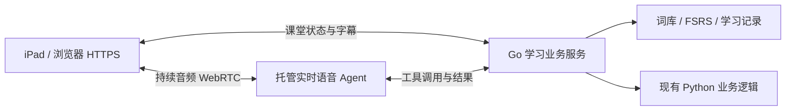

# 小天项目复盘：从最初需求到当前实现

日期：2026-09-30（北京时间）

范围：原始 Git 文档、当前工作区代码、阶段验收、运行日志、隔离启动及浏览器检查、官方技术文档。
结论：**已有可运行的网页听写系统和学习业务组件，但浏览器自然实时家教交互尚未实现，产品验收未通过。**

> **决策更新（2026-09-30）：** 本文保留复盘时的候选研究和建议作为历史依据；其中托管 RTC 优先推荐已由用户决定取代。当前架构以 Accepted [ADR-0002](adr/0002-browser-realtime-tutor.md) 为准：自研交互＋MiMo，先 WebSocket 后 pion WebRTC，火山仅为限时条件触发的 [Plan B](REALTIME-TUTOR-PLAN-B.md)。当前阶段为 Phase 13～16（R0～R3），R0 已要求真实读写工具；执行以 [.planning/ROADMAP.md](../.planning/ROADMAP.md) 为准，本文旧交付建议不用于恢复旧阶段。

## 1. 本次确认的真正目标

用户在本次复盘明确说明：原始需求中的“自然、实时的家教交互”才是真实目标。“按钮驱动听写＋识别少量语音指令”是效果不达标后的退化验证手段，不是最终产品定义。

目标体验：学生在浏览器打开小天，完成一次必要的音频授权后，可以直接说话；家教理解上下文，组织听写、回答追问、提供帮助，并允许学生中途打断。听写时学生在纸上书写，语音用于交流和控速，不把“朗读出单词”自动等同于“已正确听写”。按钮可以作为备用操作，但按钮可用不能证明语音体验已经交付。

浏览器通常需要用户交互来授权麦克风和启动音频输出。这次“一键进入”是平台启动条件，不应演变为每句话都要按住录音。[MDN 麦克风访问规则](https://developer.mozilla.org/en-US/docs/Web/API/MediaDevices/getUserMedia)

## 2. 需求如何逐步偏离

| 时间与阶段 | 当时的目标或决策 | 当前判断 |
|---|---|---|
| 2026-07-18 初始项目 | Web 实时家教，替代原 Hermes＋微信链路的 1～2 分钟等待；iPad、听写、FSRS、家长反馈 | 这是最初产品方向。初始版本 `4e4c02f:.planning/PROJECT.md` 已写入 natural / conversational AI / real-time |
| Phase 1～3 | 先做资源预算、连接管理、自定义二进制协议和 Python CLI 桥 | 基础组件有价值，但尚不能验证学生体验。`CONTEXT.md` 已明确警告“组件孤岛” |
| Phase 4～7 | SQLite、FSRS、音频生成与传输、听写状态机 | 形成了业务基础；音频预生成被放到会话创建前，产生长准备时间 |
| 2026-08-23 语音重设计 | 因浏览器识别失败，转向 MiMo；规格约束为四类指令、纸笔书写和批量批改，并要求保留旧协议与状态机 | 解决了一部分旧故障，但把交互范围收缩为命令识别；缺少恢复自然家教目标的后续里程碑 |
| 2026-09-27 Phase 8 验收 | 验证页面、按钮、进度、音频帧、iPad 布局；阶段文档标记通过 | 可证明这些组件曾被验证，不能证明连续对话、追问、打断或首个可听响应达标 |
| 2026-09-29～30 Phase 9 | 家长词库、批量管理、FSRS 设置、测试与代码修复 | 学习业务继续完善，最初实时交互缺口仍然存在 |
| 2026-09-30 本次复盘 | 用户重新确认自然实时家教目标，允许重新选型 | 应按产品体验重新建立交付顺序，不能沿用旧阶段完成比例作为验收结论 |

部分文档正文的创建年份为 2025，Git 中项目初始化和重设计规格提交发生于 2026。本文以 Git 日期及本次用户澄清为准，不根据过时文档反推用户改变了目标。

## 3. 当前到底实现了什么

| 能力 | 当前实现 | 对最终目标的状态 |
|---|---|---|
| 浏览器访问 | Go 挂载学生页、静态资源、`/ws` 和家长 `/api/v1/`；本次真实 Chromium 检查页面与连接正常 | 已有本地基础；不能说整个项目完全没有网页 |
| 学生入口 | “I want to dictate 30 words”按钮；初始状态语音按钮不可见且不可用 | 入口仍是按钮驱动，没有语音发起课程 |
| 麦克风 | `VoiceCommandController` 按住采集、松开触发识别 | 已有短录音能力，没有持续会话 |
| ASR | 先汇集整段 PCM，再封装 WAV，请求 MiMo 转写 | 属于整段识别；当前主路径没有持续上传到流式 ASR 的会话 |
| 理解能力 | 规则匹配＋LLM 分类；输出 next/repeat/pause/resume/cannot_write/none | LLM 被用作命令分类器，没有对话历史和教学交流循环 |
| 家教帮助 | “不会写”直接映射 next_word，闲聊被分类为 none | 缺少解释、提示、追问和澄清，无法像家教一样接话 |
| 语音输出 | MiMo 逐词完整合成，缓存 PCM；失败后整批回退 Python＋火山 TTS＋转换 | 可读词，主路径不是端到端的即时生成与播放 |
| 播放 | 传输 20ms PCM 帧，听写页攒到 word_complete 才播放 | 分帧传输成立，边到边播的听写体验不成立；FEEDBACK 有独立即时播放分支 |
| 对话打断 | 有听写 pause/repeat 事件，但没有自然对话生成、音频队列和上下文截断的完整取消机制 | 未实现连续对话所需的打断语义 |
| 学习业务 | 词库、分类/单元、FSRS、选词锁、答案提交、批改和记录均有代码与测试 | 值得复用；业务代码存在不等于全部真实用户验收通过 |
| 恢复与部署 | 跨连接恢复和 VPS 演练在阶段文档中仍有待办；现有入口是 HTTP | 不能把本机网页验收等同于目标 iPad 或正式访问环境已交付 |

关键代码证据：

- `cmd/service/main.go:510` 附近挂载网页与 API，`:553` 启动公共监听。
- `pkg/web/static/js/voice-command-controller.js:127` 每次启动录音，`:191` 松开停止，`:220` 发送 voice_command。
- `cmd/service/voice.go:156` 附近汇集录音后才调用 `pipeline.Process`；`pkg/voice/pipeline.go` 将整段 PCM 包成 WAV。
- `pkg/voice/intent.go:32` 将 cannot_write 映射下一词；`:150` 的模型提示明确要求仅分类，闲聊为 none。
- `pkg/web/static/js/ui-components.js:1142` 只有已有听写会话时才能使用语音按钮。
- `pkg/session/session.go:205` 等待整批生成；`pkg/tts/generator.go:148` 顺序合成每个词。
- `pkg/tts/mimo_synth.go` 实际调用 `Synthesize`，并未使用已存在的 `SynthesizeStream`。
- `pkg/tts/streamer.go:58` 读取已完成的缓存，`:77` 按 20ms 定时发送；`audio-controller.js:213` 缓存，`:286` 整词播放。

## 4. 启动慢：实测与推断分开

本次使用当前工作区构建，在独立的 18080/18081 端口、独立数据库和缓存下启动，未使用真实词库、未启动听写、未调用模型。三次均检查根页面、两个 JS 文件、CSS 和健康检查，全部 HTTP 200。

| 测量对象 | 结果 | 能说明什么 |
|---|---|---|
| 当前代码构建 | 1.830 秒 | 使用已有 Go 编译缓存；不是清空缓存后的冷构建 |
| 进程启动 → 根页面 HTTP 200，第 1 次 | 1.782 秒 | 包含创建进程、首次请求等本机开销 |
| 第 2、3 次 | 各 0.520 秒 | 当前隔离环境下服务进程本身可以较快就绪 |
| 历史日志：已加载配置 → 日志声明监听 | 约 0.001～0.002 秒 | 仅初始化片段，不包含编译、真正绑定成功、页面加载或模型响应 |
| 历史 `server.log:21～23`：申请会话 → 创建成功 | **23.906 秒 / 10 个词** | 同一连接、一次成功会话；是历史数据，不是本次重新调用云端测量 |
| 现有浏览器测试允许等待 session_ready | 60 秒 | 当前验收容忍长等待，未约束用户期待的 1.5 秒响应 |

历史样本仅一条，不能当作平均值/P95，也不能推导“30 个词一定需要多少秒”。但是，顺序等待整批合成的阻塞由代码直接确认。原始启动脚本每次重新构建，还包含旧监听处理、配置和环境加载；本次未完整重跑该脚本，也未测冷编译，因此不能断言用户所遇到的所有慢启动都已解释。

现有主路径：

所以学生的首次听见声音至少经过整批准备、第一词传输和浏览器播放调度。将缓存文件分成小帧发送，不能抵消前面的等待。

## 5. iPad 的语音访问还存在入口问题

`run.ps1` 输出的是 `http://<host-LAN-IP>:8080/test-interface.html`。这既指向开发测试页，又是普通局域网 HTTP。`getUserMedia` 要求安全上下文；电脑的 localhost 例外不能推广到 iPad 访问另一台机器的局域网地址。[MDN 说明](https://developer.mozilla.org/en-US/docs/Web/API/MediaDevices/getUserMedia)

现有录音组件明确检测 `navigator.mediaDevices.getUserMedia`，不可用时隐藏录音按钮；即使页面和 WebSocket 正常，语音仍可能完全消失。这一机制由代码和浏览器规则确认，本次没有操作真实 iPad 复测。

本次 Chromium 在 `127.0.0.1:18080` 下检查结果：页面标题“听写小助手”，WebSocket“已连接”，安全上下文与麦克风 API 均可用；初始页仅开始听写按钮可见，语音按钮隐藏且禁用；无页面脚本异常。该检查没有授权实际麦克风、没有发送语音、没有验证听感。

## 6. 为何已有测试通过仍达不到预期

这主要是验收对象变了，而非没有写测试。

1. Phase 8 的目标是界面请求、进度与响应式布局，本来就没有覆盖完整自然对话。
2. `tests/e2e/dictation-flow.spec.js:74` 允许开始等待 60 秒；`:122～129` 没有收到音频帧时只加注释，测试仍可通过。
3. AudioContext running 和收到 PCM 帧不能证明学生真正听见了声音，尤其不能证明低延迟、发音质量和打断。
4. `REQUIREMENTS.md` 的 DICT-05 已勾选，而 Phase 6 仍记录行为待测，Phase 8 也将首词掐表留作待办；这条性能要求应重新建立端到端证据。
5. 模拟录音、模拟识别和命令映射的测试验证的是代码协议，不能证明儿童真实语音和目标网络的效果。
6. `STATE.md` 的 96% 是计划完成进度，不能解释为最终产品完成 96%。

本次重新执行：`npm test` 的 7 个测试脚本通过；`go test ./pkg/voice ./pkg/tts ./pkg/ws` 通过；当前工作区构建通过。它们证明基础组件仍可工作，不构成自然实时家教的验收。

## 7. 选型评估：重做交互层，保留学习业务

| 路线 | 优势 | 主要代价/待验证项 | 本项目建议 |
|---|---|---|---|
| 在旧 PCM 协议上补持续录音＋VAD＋流式 ASR/LLM/TTS | 可逐步复用 Go 代码，数据控制明确 | 自行处理判停、回声、打断、播放调度、取消和跨路由时序；很容易继续只修组件 | 不作为主路线 |
| 托管 RTC＋语音 Agent，可采用流式链路或端到端混合编排 | 浏览器双向音频交给 SDK；服务端执行词库等工具；本机无需运行音频模型 | 需要开通 RTC/模型/工具接口权限，核对 iPad 支持、实际网络和费用 | **首选验证方向：火山 RTC＋支持工具的 Agent 模式** |
| 浏览器 WebRTC＋原生实时模型＋服务端工具 | 基础对话链路短，模型维护会话，便于自然交流 | 服务可用地区、实际访问、费用与工具执行可靠性需实测 | OpenAI Realtime 作为对照候选，不默认已有访问权限 |
| LiveKit Agents＋流式 ASR/LLM/TTS 或实时模型 | SDK 提供轮次管理、打断和模型接入，业务编排灵活 | 自托管增加媒体服务与 Agent 运行维护；资源取决于所用模型和处理插件 | 托管/独立 Agent 部署作为第二候选，不把完整栈硬塞进旧 1C1G 预算 |

火山官方 RTC 文档明确区分纯端到端与混合编排：需要工具时可采用支持方舟模型的混合模式，且部分旧控制接口在端到端模式无效。因此必须验证工具接入和动态课堂状态，不能把低延迟闲聊演示直接当成家教完成。[火山端到端与混合编排](https://docs.volcengine.com/docs/real_time_communication/Accessend-to-endreal-timespeechlargemodel?lang=zh)

OpenAI 官方说明浏览器可通过 WebRTC 连接实时模型，后端负责凭证和会话初始化，音频不需要沿用业务侧的逐帧处理。[Realtime WebRTC](https://developers.openai.com/api/docs/guides/voice-webrtc?voice-api=realtime)

LiveKit 官方 SDK 覆盖流式处理、轮次检测及打断；其一般 Agent server 起步建议是 4 核/8GB，并非单会话强制最低要求。这说明资源必须按实际组件评估，旧 150MB Go 预算不能套到整个语音 Agent 系统。[Agents 能力](https://docs.livekit.io/agents/)、[部署资源](https://docs.livekit.io/deploy/custom/deployments/)

MiMo 当前官方 ASR 文档的流式示例仍先把整段 WAV/MP3 编码后提交，再流式返回文本。**输出流式不代表麦克风输入是持续双向会话。** 本项目不能仅加 `stream=true` 就宣称完成实时家教；这也不是断言 MiMo 未来或其他产品没有实时能力。[MiMo ASR 当前接口](https://mimo.mi.com/docs/en-US/quick-start/usage-guide/audio/Speech-Recognition)

以上是基于已查官方能力和项目约束的架构判断，没有进行提供商之间的实际语音性能排名。现有火山 TTS key 和 MiMo key 不证明已开通 RTC、端到端对话或工具调用权限；未核对具体账单和额度。

## 8. 新系统的职责边界

实时 Agent 负责听、理解、说、判停、打断和课堂交流。Go 服务负责真正的课程状态、词库读取、选词锁、结果记录和 FSRS 更新。模型必须通过业务工具改变课程状态，不能仅说“进入下一词”却没改变后台。

建议最小工具：`start_lesson`、`get_lesson_state`、`repeat_current_word`、`advance_word`、`pause_lesson`、`resume_lesson`、`get_hint`、`finish_lesson`。每次写操作有 `request_id` 和预期课堂版本；重复回调不重复推进，旧回调不能影响新课堂。暂停时保存当前位置；被打断的声音需要取消，并保证对话上下文反映学生实际听到的部分。

纸笔听写有独立的等待时间：孩子停下来写字不代表课堂应自动跳词。当前 DICTATING 超时可推动下一词，新方案将其改为温和询问或等待；长时间无人活动才退出。对话的 speaking/listening/thinking 与教学的 waiting_for_writing/paused/review 是两组不同状态，不继续混进一个状态机。

原词库管理、SQLite 数据、FSRS 算法、选词锁规则、批改与学习记录保留。Python 首期继续承担这些业务，不同时进行语言迁移；音频预生成、旧命令分类器与两套麦克风识别不再作为新交互主路径。固定词音可按内容缓存、预取下一词，但不等待整课生成完再开始。

## 9. 重新安排交付顺序

### R0：先交付可验收的浏览器自然语音体验

独立的 `/tutor/` 入口，隔离旧听写页和旧预生成链路。选择一个可用的托管 RTC/实时语音候选，完成 HTTPS、一次授权、持续听说、字幕、打断、错误提示与会话释放。先用 3 个固定教学词，让老师和学生真实交流。

验收场景必须包含“我今天只想练三个词”“刚才那个是什么意思”“等一下我还没写完”“能慢一点吗”，并能在老师说话时打断。此时不优先接 OCR、家长统计或 100 人并发。

R0 的决定性门槛是**真实 iPad 和用户网络上的连续对话体验**，不是 demo 静态页、录音上传成功或代码检查。若候选不达标，记录具体失败和时序，替换候选；不通过延长测试等待或把语音改成按钮来过关。

### R1：把对话接到真实课堂

接入最小业务工具，让口头发起、选词、重复、等待书写、暂停恢复和求助都改变真实课堂状态。先验证 3～5 词，再扩大到 30 词。初始化立即反馈准备状态，首词按需获取，余下预取不阻塞对话。

### R2：闭环学习结果

接入现有拍照/人工提交、批改、家长确认和 FSRS。将自然家教对话与真实学习记录贯通，验证完成一次课程及下一次复习。跨连接恢复以课堂 ID 为依据，不能绑定 Go Client 内存地址。

### R3：再验证部署与容量

按实际单会话资源、网络和账单评估生产部署及并发。1C1G 优先用于轻业务服务；若需要独立 Agent 或托管媒体，分别预算。100 人连接能力不等于 100 个真实语音会话性能已达标。

## 10. 新验收标准

以下数值是本次建议的验收目标，**不是当前实现或提供商保证**。把原有 1.5 秒目标拆成用户可感知的指标，使用同一设备/网络测试。

| ID | 验收项 | 建议标准 |
|---|---|---|
| RT-01 | 网页可访问 | 目标 iPad Safari 经可信 HTTPS 打开正式入口，资源与状态可见；HTTP 下明确提示语音不可用原因 |
| RT-02 | 进入会话 | 授权完成后，一次点击开始；后续至少 10 轮无需反复按住录音 |
| RT-03 | 自然交流 | 发起 3 词课程、指代上一词、问含义、求慢读、表示没写完均正确响应；至少覆盖 20 条含上下文场景 |
| RT-04 | 首次与轮次延迟 | 授权完成至首次可听问候目标 ≤3 秒；句末至首个实际可听响应目标 P50≤1.5 秒、P95≤2.5 秒，至少 30 次测量 |
| RT-05 | 打断 | 学生开口至旧响应停止目标 P95≤500ms；旧生成/排队音频不复活，下一轮理解实际已播放内容 |
| RT-06 | 教学节奏 | 保持等待书写，不因普通沉默自动跳词；求助可以提供提示、询问是否跳过，不直接等同“不会写→下一词” |
| RT-07 | 数据一致性 | 对话工具回调与按钮都经过同一业务服务；重试不重复推进，进度、字幕、口头反馈一致 |
| RT-08 | 稳定性与恢复 | 15 分钟真实练习；切后台和断网恢复有明确状态；恢复课堂进度，禁止偷偷新建课程造成跳词 |
| RT-09 | 学习闭环 | 完成听写、提交、批改及确认后，正确记录结果并影响后续 FSRS 选词 |
| RT-10 | 故障可见 | 麦克风、提供商或网络故障可见；备用按钮可用，但界面明确处于降级模式，不能标记语音验收通过 |

必须记录：页面就绪、授权完成、连接就绪、speech_started/ended、工具开始/结束、首个收到的音频、首个实际播放的音频、打断开始/停播及课堂版本。以真实可听音频衡量响应，不以 HTTP 成功、收到帧或模型输出结束替代。

## 11. 本次交付与限制

已完成需求演变梳理、代码审计、官方选型研究、独立启动测量、真实 Chromium 初始页检查及现有组件测试；形成本文与 `docs/adr/0002-browser-realtime-tutor.md`。

当前工作区在复盘前已有多处未提交代码修改；本次基于它们检查和构建，没有回滚。诊断产物存于 `.scratch/project-audit/`；三次测量服务及浏览器检查服务均只操作独立端口和数据库。没有清空真实词库、解除真实选词锁或重新调用付费模型。

本次没有实现新的 RTC/实时语音集成，也没有证明任何候选提供商在真实 iPad、儿童语音和用户网络下已达标。新系统需要取得对应服务权限后按 R0 实测；不能用当前文档交付代替那次产品验收。
